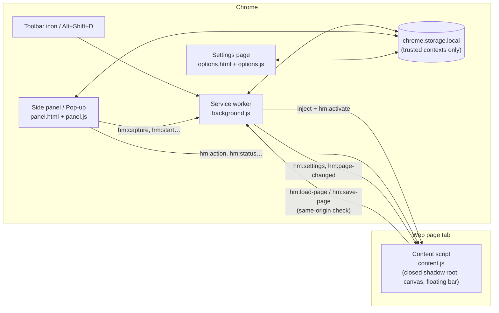

<p align="center"></p>

<h1 align="center">Handmark</h1>
<p align="center"><b>Draw on any webpage like it's paper.</b></p>

Handmark is a Chrome extension for drawing over web pages while you record, present, teach or research. It has:
- a marker that looks hand-drawn
- arrows that draw their own heads
- a highlighter, handwritten notes and a laser pointer

Your drawings stay on the page and come back when you reopen it, weeks later too. Everything stays on your computer: no account, no server, no tracking.

---

## Contents

- [Features](#features)
- [Install](#install)
- [How to use](#how-to-use)
- [Keyboard shortcuts](#keyboard-shortcuts)
- [Settings](#settings)
- [How saving works](#how-saving-works)
- [Privacy and security](#privacy-and-security)
- [How it works](#how-it-works)
- [Project files](#project-files)
- [Data formats](#data-formats)
- [Message reference](#message-reference)
- [Testing](#testing)
- [Known limitations](#known-limitations)
- [Publishing to the Chrome Web Store](#publishing-to-the-chrome-web-store)
- [Ideas for later](#ideas-for-later)
- [Contributing](#contributing)
- [Licence](#licence)

---

## Features

**Drawing tools**

| Tool | Key | What it does |
|---|---|---|
| Marker brush | `B` | The default. Gets slightly thinner when you move fast, never below about 65% width, with softly tapered ends, like a felt-tip pen. |
| Pen | `P` | An even line for precise marks. |
| Highlighter | `H` | Wide, see-through, blends with the text underneath instead of covering it. |
| Arrow | `A` | Draw any curve; a hand-style arrowhead is added at the end, angled along the curve. |
| Text | `T` | Type a note in a handwriting font (Caveat). Supports Latin accents and diacritics (e.g. Ą Č Ę Ė Į Š Ų Ū Ž, é, ñ, ß). |
| Laser pointer | `L` | A glowing trail that disappears after a moment. Never saved. |
| Eraser | `E` | Removes whole marks you drag over. |
| Click-through | `V` / `Esc` | Use the page normally (scroll, click links); your drawings stay visible. |

**Line correction**
- **Stabiliser** (Off / Low / High, key `S`): the line trails slightly behind your cursor so small shakes smooth out. Low suits handwriting; High suits big shapes.
- **Hold to straighten:** pause for half a second at the end of a stroke and it snaps into a straight line that keeps the marker's hand-drawn edge. Works for arrows too.

**For recordings and presentations**
- **Fade mode** (`G`): new marks fade away after 3, 5 or 8 seconds and are never saved.
- **Laser pointer** for pointing without leaving marks.
- **Side panel layout:** the controls dock in Chrome's side panel, so they never cover the page and are easy to crop out of a screen recording.

**Three layouts for the controls** (choose in Settings)
1. **Side panel** (default): docked in Chrome's built-in side panel and stays open across tabs.
2. **Pop-up:** click the toolbar icon to pick a tool; it closes when you click the page.
3. **Floating:** a draggable bar on the page with 10 px rounded corners. It collapses to a small handle when drawing is off.

**Colours and sizes**
- Four preset colours (yellow `#FFC702`, cream `#F6F0E2`, black `#141312`, orange `#FA4101`) plus a custom colour picker.
- Three sizes (S, M, L).

**Saving and sharing**
- Drawings save automatically per page and come back when you return.
- Saved pages list with previews, Open and Delete.
- Per-page "Keep drawings" switch.
- Export and import of all drawings as a backup file.
- Screenshots and recordings, including your drawings (see below).
- Undo, redo and clear page.

**Screenshots and recordings**

Open the camera button in the controls, or use a shortcut:

| Capture | Shortcut | What you get |
|---|---|---|
| Full page | `Ctrl+Shift+F` | The whole page, top to bottom, stitched from screens |
| Visible window | `Ctrl+Shift+S` | Everything you can see in the tab |
| Select an area | `Ctrl+Shift+E` | Drag a rectangle over the page; `Esc` cancels |
| Record an area (video) | `Ctrl+Shift+K` | Drag a rectangle, then everything in it is recorded (scrolling, your marker, the laser) until you press **Stop** or the shortcut again. Up to 10 minutes. |

Captures open in the **editor**, where you can make them presentable:
- **Background:** 10 preset gradients, a solid colour, **your own gradient** (two colours, linear with an angle or radial), **your own image** (pick a file or drop it on the preview; blur and darken sliders), or transparent
- **Frame:** a browser window (light or dark, with the site's address) or a plain window with traffic lights
- **Aspect ratio:** auto, 16:9, 4:3, 1:1, 4:5 or 9:16 (for slides and social posts)
- **Padding, rounded corners and shadow** sliders
- **Inset border:** a mat around the capture, like a passport photo: width slider, white, black, frosted glass or any colour, and separate **inner corners** for the capture inside it
- **Download PNG**, **Copy** to the clipboard, or **Save original**
- For recordings: preview, **Export styled video** (MP4 where Chrome supports it, otherwise WebM) or **Save original video**

Your style is remembered for the next capture. Your background image is kept in Handmark's local storage (resized to at most 3840 px) until you remove it. To skip the editor for screenshots, choose **Settings → After a screenshot → Save straight away**. Files go to `Downloads/Handmark`.

Recording needs one click on the Handmark icon (or `Alt+Shift+D`) on that tab first: Chrome only lets extensions record a tab the user has explicitly invoked them on.

---

## Install

Handmark is not on the Chrome Web Store yet. Install it from this repository:

1. Download this repository: **Code → Download ZIP**, then unzip it, or `git clone` it.
2. Open **`chrome://extensions`** in Chrome.
3. Turn on **Developer mode** (top right).
4. Click **Load unpacked** and choose the **`extension`** folder (the one with `manifest.json` in it).
5. Click the puzzle-piece icon in Chrome's toolbar and **pin Handmark**.

Requires Chrome 116 or newer. Should also work in other Chromium browsers with side panel support (Edge, Brave), but only Chrome is tested.

To update: replace the files and click the reload arrow on Handmark's card in `chrome://extensions`.

---

## How to use

1. Open any web page.
2. Click the **Handmark icon**, or press **`Alt+Shift+D`**. The side panel opens and you can draw straight away.
3. Pick a tool in the panel or with a key (`B`, `P`, `H`, `A`, `T`…).
4. Press **`F`** to turn drawing off and use the page; press `F` again to draw.
5. Close the tab whenever you like; your drawings are saved. Next time, click the icon on that page and they come back. To see them as soon as a page opens, turn on **Settings → Show drawings automatically**.

**Pages Handmark can't draw on:** Chrome blocks all extensions on `chrome://` pages, the Chrome Web Store, other extensions' pages and Chrome's built-in PDF viewer.

### Recording tips (OBS or similar)
- Keep the **side panel** layout and add a Crop filter to the browser source so viewers only see the page.
- Turn on **fade** (`G`) so marks clean themselves up.
- Use the **laser** (`L`) to point at things without drawing.

---

## Keyboard shortcuts

Single-key shortcuts only work while Handmark is running on the tab, and never while you are typing in a text field.

| Keys | Action |
|---|---|
| `Alt+Shift+D` | Start / stop Handmark on this tab (change it at `chrome://extensions/shortcuts`) |
| `F` | Drawing on / off |
| `B` `P` `H` `A` `T` | Marker · Pen · Highlighter · Arrow · Text |
| `L` `E` | Laser pointer · Eraser |
| `V` or `Esc` | Click-through |
| `1` `2` `3` | Size S / M / L |
| `S` | Stabiliser Off → Low → High |
| `G` | Fade on / off |
| `Ctrl+Z` / `Ctrl+Shift+Z` | Undo / Redo |
| `C` | Clear this page (undo brings it back) |
| `Ctrl+Shift+S` | Screenshot of the visible window |
| `Ctrl+Shift+F` | Full-page screenshot |
| `Ctrl+Shift+E` | Screenshot of an area you select |
| `Ctrl+Shift+K` | Record an area as video (press again to stop) |
| `Enter` / `Esc` (in a note) | Place the note / cancel it |

On a Mac, use `Cmd` instead of `Ctrl`.

---

## Settings

Open them with the gear icon in the controls, or right-click the toolbar icon → **Options**.

| Setting | Default | Notes |
|---|---|---|
| Where the controls live | Side panel | Side panel, Pop-up from the toolbar icon, or Floating on the page. |
| Fade time | 5 seconds | 3, 5 or 8 seconds. Fade itself is switched on and off with `G` or the clock button. |
| Keep drawings on new pages | On | Sets the per-page "Keep drawings" switch for pages you haven't drawn on yet. |
| Show drawings automatically | Off | Asks Chrome for access to all sites (see [Privacy](#privacy-and-security)). Without it, drawings come back when you click the icon on a page. |
| Saved drawings | — | Search, open and delete saved pages; export and import backups; delete everything. |

---

## How saving works

- **Automatic:** each finished mark is saved after a short pause (400 ms). There is no save button.
- **Per page:** drawings belong to the page's address. Before saving, Handmark cleans the address:
  - **tracking parameters are removed** (`utm_*`, `fbclid`, `gclid`, `msclkid`, `mc_cid`, `igshid` and similar), so the same article opened from different links finds the same drawings
  - **plain `#anchors` are removed**, but app routes like `#/settings` or `#!page` are kept
  - **login details in the address are removed**
- **Page coordinates:** marks are pinned to positions on the page, not on the screen, so they scroll with the content.
- **Window width:** Handmark remembers the window width you drew at. If you come back at a noticeably different width (more than 8%), the text may have reflowed, so you get a notice with **Match width** (resizes the window) or **Show anyway**.
- **Not saved:**
  - fading marks and the laser
  - anything in incognito windows
  - pages where you've switched "Keep drawings" off
- **Limits per page:** 5,000 marks, 20,000 points per mark, 500 characters per note, 5 MB in total.
- **Single-page apps:** Handmark checks the address once a second and switches to the right page's drawings when a site changes pages without reloading.

---

## Privacy and security

- **No network requests at all:** no server, no account, no analytics. The handwriting font is bundled.
- **Everything stays local** in Chrome's extension storage. This includes the address and title of each page you drew on. Delete single pages in the side panel, or everything in Settings. Uninstalling removes all data.
- **Incognito is never saved.**
- **Minimal permissions:**
  - `activeTab`, `scripting`, `storage`, `unlimitedStorage`, `sidePanel`, `downloads`
  - access to all sites is **optional and off by default**
- **Hardened against hostile pages:**
  - it ignores fake input
  - it keeps its layer in a closed shadow root
  - storage is locked to the extension
  - a page can only ever load drawings for its own website
  - there is no `innerHTML` or `eval` anywhere
  - imports are fully validated
  - page-triggered actions are rate-limited

Full threat model and test results: **[SECURITY.md](SECURITY.md)**. Privacy policy: **[PRIVACY.md](PRIVACY.md)**.

---

## How it works



**Starting Handmark on a tab:**
1. A click on the icon (or the shortcut) gives the extension temporary access to that tab (`activeTab`).
2. The service worker opens the side panel straight away, while Chrome still counts the click.
3. It injects `common.js`, `controls.js` and `content.js` into the tab and sends `hm:activate`.
4. With the pop-up layout, opening the pop-up grants the same access, and the pop-up starts Handmark itself.

**The drawing layer:**
- `content.js` adds one element with a **closed shadow root**, fixed over the viewport, containing:
  - a `<canvas>` the size of the viewport
  - the floating bar
  - notices and the note input
- Marks are stored in **page coordinates**, and on every scroll the canvas redraws only the marks in view. This keeps the canvas small even on very long pages.
- Rendering uses `requestAnimationFrame` and only keeps animating while something is moving: a stroke in progress, fading marks or the laser.

**The marker brush:**
- Each point records position and time, so speed can be calculated.
- Width is `size × max(0.65, 1 − speed × 0.18)`, eased over the first and last three points for soft ends.
- The stroke is drawn as one filled outline (left and right edges offset along the normal, smoothed with quadratic curves), so it never shows overlapping "beads".
- The **stabiliser** moves each new point only part of the way towards the cursor: 100%, 45% or 20%.
- **Hold to straighten** is a 500 ms timer that restarts on every movement. When it fires, the stroke is replaced by evenly spaced points on a straight line with a tiny natural wobble.

**Saving:**
- The content script never touches storage itself.
- It asks the service worker with `hm:load-page` and `hm:save-page`.
- The worker checks that the address is on the **same website** as the tab asking, validates the data, and reads or writes `p:<address>`.
- When storage changes, for example after a delete in the side panel or an import, the worker sends every tab `hm:page-changed` with short hashes of the changed keys. A tab whose key matches reloads its own drawings.
- Saves are queued one after another. Records are compared with order-independent JSON (`HM.stableJson`), so a tab never reloads its own just-saved drawings.

**Screenshots:**
- **Visible area:** the page hides Handmark's controls (`hm:capture-prepare`), then the worker calls `chrome.tabs.captureVisibleTab`.
- **Full page:** the worker scrolls the page one screen at a time (`hm:capture-scroll`) and captures each screen, waiting about 0.6 s between captures (Chrome's limit). It then stitches the screens on an `OffscreenCanvas`.
- The height is capped at 40 screens or 30,000 px.
- **Area:** the page shows a selection layer in its shadow root; after you drag, the worker captures the visible tab and crops it.
- The image is stored in the extension's own IndexedDB (`media.js`, kept for a day, at most 12 items) and `editor.html#<id>` opens next to the tab. With "Save straight away" it goes to `chrome.downloads` instead.

**Recordings:**
- The worker gets a stream id with `chrome.tabCapture.getMediaStreamId` and opens an offscreen document (`offscreen.html`).
- The offscreen document crops every captured frame to the chosen area (`MediaStreamTrackProcessor` → canvas → `MediaStreamTrackGenerator`) and encodes it with `MediaRecorder`.
- The page shows a dashed frame just outside the area and a Stop button, so neither appears in the video.
- When it stops, the video is stored locally and opens in the editor. **Export styled video** plays it once while drawing every frame with the chosen style onto a canvas, which is recorded again.

**Styling** (`beautify.js`) is one renderer used for the preview, the PNG and the video, so they always match.

---

## Project files

```
handmark/
├── extension/              ← load this folder in chrome://extensions
│   ├── manifest.json
│   ├── background.js
│   ├── common.js
│   ├── content.js
│   ├── controls.js
│   ├── pages.js
│   ├── panel.html
│   ├── popup.html
│   ├── panel.js
│   ├── panel.css
│   ├── options.html
│   ├── options.js
│   ├── editor.html, editor.css, editor.js
│   ├── beautify.js
│   ├── media.js
│   ├── offscreen.html, offscreen.js
│   ├── fonts/
│   │   ├── caveat-700-latin.woff2
│   │   ├── caveat-700-latin-ext.woff2
│   │   └── OFL.txt
│   └── icons/
│       └── icon-16.png, icon-32.png, icon-48.png, icon-128.png
├── tests/
│   ├── e2e.test.mjs
│   └── fixtures/
│       ├── article.html
│       └── malicious-backup.json
├── store/
│   ├── STORE_LISTING.md
│   ├── make-assets.mjs
│   ├── demo-page.html
│   ├── promo-small-440x280.png, promo-marquee-1400x560.png
│   └── screenshots/
├── package.json
├── LICENSE
├── README.md
├── SECURITY.md
├── PRIVACY.md
├── CHANGELOG.md
└── .gitignore
```

### `extension/manifest.json`
The extension's definition (Manifest V3):
- name, version and icons
- the service worker, side panel page and options page
- the toolbar action and the `toggle-handmark` command (`Alt+Shift+D`)
- the permissions and the optional `<all_urls>` host permission
- a strict content security policy for the extension's own pages

It deliberately has no `web_accessible_resources` and no `externally_connectable`.

### `extension/background.js` (service worker)
The coordinator. It:
- keeps the toolbar action in sync with the chosen layout (pop-up or not)
- on icon click or shortcut, opens the side panel (side layout) and injects and starts the content script on that tab
- registers or unregisters the "show drawings automatically" content script when the optional permission is granted or removed
- locks `chrome.storage.local` to trusted contexts and is the **only** way content scripts read or write drawings, with a same-origin check on every request
- broadcasts settings changes and page-data changes (as hashes) to tabs
- takes visible and full-page screenshots and saves them with `chrome.downloads`
- serves the bundled font to pages as bytes
- validates every message: sender must be this extension, the type must be known, tab-targeted actions must be for the active tab, and page-triggered actions are rate-limited

### `extension/common.js`
Shared by every part of the extension. It defines `HM`:
- **Constants:** colours, sizes, tools, layouts, fade times, default settings, size limits.
- **`normalizeUrl(href)`:** cleans an address before it's used as a storage key (see [How saving works](#how-saving-works)).
- **`sanitizeSettings`, `sanitizeStroke`, `sanitizePage`:** rebuild data field by field from anything untrusted (storage, imports, messages), dropping unknown fields and rejecting bad values.
- **`isOpenableUrl`:** only `http:` and `https:` addresses may be opened from the saved list.
- **`pageKey`, `hashKey`, `stableJson`:** storage key helpers and order-independent comparison.

### `extension/content.js` (runs in the web page)
The drawing layer. It holds:
- the closed shadow root UI: canvas, floating bar, toast, width notice, note input
- pointer input for all tools, the stabiliser, hold-to-straighten, the eraser hit test and laser trails
- the renderer (marker outline, pen, highlighter with `multiply` blending, arrowheads, text)
- undo and redo history (up to 200 steps, kept in memory)
- loading and saving via the service worker, the single-page-app address watcher and the width check
- keyboard shortcuts (only while active, only trusted events, never in editable fields)
- the message handler for commands from the panel and service worker, including the screenshot steps

It runs once per page (a guard prevents double injection) and makes no network requests.

### `extension/controls.js`
Builds the tool controls with plain DOM methods: tools, colours and custom colour, sizes and stabiliser, fade, undo, redo, clear, the screenshot menu and settings. The same builder is used in three places:
- vertical, in the side panel and pop-up
- horizontal, in the floating bar inside the page

It contains its own CSS and the SVG icon set. Buttons ignore synthetic clicks.

### `extension/pages.js`
Used by the side panel and settings page:
- **saved pages list:** previews drawn on a small canvas, title, site, number of marks, date, Open and two-step Delete
- **export:** downloads `handmark-backup-YYYY-MM-DD.json`
- **import:** validates the file and merges it, replacing pages with the same address
- **delete all**

All page titles and addresses are shown with `textContent`.

### `extension/panel.html`, `extension/popup.html`, `extension/panel.js`, `extension/panel.css`
The side panel and the toolbar pop-up share one script and stylesheet (`data-mode="side"` or `"popup"`). They show:
- the current page's status, with **Start drawing here** and **Turn drawing on/off**
- the width warning with **Match width**
- the **Keep drawings on this page** switch
- the controls
- in the side panel only: saved pages, export and import, and a shortcut cheat sheet

The panel follows the active tab and talks to the page with `chrome.tabs.sendMessage`. The pop-up starts Handmark on the tab as soon as it opens.

### `extension/options.html`, `extension/options.js`
The settings page: controls layout, fade time, keep-by-default, the "show drawings automatically" switch (requests or removes the optional permission), a link to Chrome's shortcut settings, saved drawings with search, export, import and delete all, and a privacy summary.

### `extension/editor.html`, `extension/editor.css`, `extension/editor.js`
The capture editor: background, frame, aspect ratio, padding, corners and shadow; download, copy, save original; video preview and styled video export.

### `extension/beautify.js`
`HMStyle`: the style presets, `sanitizeStyle` and the canvas renderer shared by the editor's preview and exports.

### `extension/media.js`
`HMMedia`: a small IndexedDB store for captures on their way to the editor. Old items are pruned automatically.

### `extension/offscreen.html`, `extension/offscreen.js`
The recorder. Exists only while a recording is running.

### `extension/fonts/`
Caveat Bold in two subsets (Latin, and Latin Extended for diacritics), downloaded from Google Fonts and bundled so no request ever leaves the browser. `OFL.txt` is the font's licence (SIL Open Font License 1.1).

### `extension/icons/`
The extension icon at 16, 32, 48 and 128 px: a hand-drawn yellow loop over a cream underline on a dark rounded square.

### `tests/e2e.test.mjs`
End-to-end tests with Playwright. They start a local web server, load a test copy of the extension into Chromium with site access granted (a test can't click the toolbar icon), and check:
- drawing, address cleaning, notes with diacritics
- fake key presses are ignored
- undo and redo, fading marks not saved
- shortcuts don't fire while typing in a page field
- restoring after reopening the page
- the malicious import file is cleaned
- site isolation
- full-page, window and area screenshots, the editor (style, remembered style, download), and the recorder (crop, editor, styled export)

### `tests/fixtures/article.html`
A long test page with paragraphs and a text field.

### `tests/fixtures/malicious-backup.json`
A crafted backup with a `javascript:` address, HTML and script in titles and notes, a named colour, an infinite coordinate, extra fields and `__proto__` keys. The import must clean or reject all of it.

### `package.json`
Developer scripts only. The extension itself has no dependencies:
- `npm test`: run the end-to-end tests
- `npm run check`: syntax-check every script
- `npm run zip`: build `handmark.zip` for the Chrome Web Store
- `npm run store-assets`: regenerate the store screenshots and promo tiles

### `store/`
Chrome Web Store kit: the listing text, the script and demo page that generate screenshots and promo tiles from the real extension, and the generated images.

### `LICENSE`
MIT licence for the code. The Caveat font keeps its own SIL Open Font License.

### `SECURITY.md`, `PRIVACY.md`, `CHANGELOG.md`
The threat model and mitigations, the privacy policy (needed for the Chrome Web Store) and the version history.

---

## Data formats

### Settings (`settings` key)
```jsonc
{
  "tool": "brush",        // brush | pen | hl | arrow | text | laser | eraser | through
  "color": "#FFC702",     // #RRGGBB
  "custom": "#2F6BFF",    // last custom colour
  "size": 2,              // 1 | 2 | 3  →  4 | 7 | 12 px
  "stab": 1,              // 0 off | 1 low | 2 high
  "fade": false,
  "fadeMs": 5000,         // 3000 | 5000 | 8000
  "layout": "side",       // side | popup | floating
  "keepDefault": true
}
```

### A saved page (`p:<normalised address>` key)
```jsonc
{
  "url": "https://example.com/article",
  "title": "Article title",
  "updated": 1763380000000,   // ms since 1970
  "vw": 1440,                 // window width when drawn
  "keep": true,
  "strokes": [
    { "t": "brush", "c": "#FFC702", "w": 7, "p": [x, y, ms, x, y, ms, …] },
    { "t": "text",  "c": "#F6F0E2", "x": 120, "y": 340, "fs": 40, "v": "note text" }
  ]
}
```
- `p` is a flat list of points: page x, page y and milliseconds since the stroke began. The time is used to work out speed for the marker width.
- Line types are `pen`, `brush`, `hl` (highlighter) and `arrow`.

### Backup file
```jsonc
{ "app": "handmark", "version": 1, "exported": "2026-11-17T10:00:00.000Z", "pages": [ /* saved pages as above */ ] }
```

---

## Message reference

All messages are `{ type: 'hm:…', … }`. Every receiver checks `sender.id === chrome.runtime.id`.

**To the service worker**

| Type | From | Purpose |
|---|---|---|
| `hm:get-settings` | page | Current settings |
| `hm:set-settings` | page | Merge and save settings |
| `hm:load-page` `{url}` | page | Saved record for `url`, **same origin as the tab only** |
| `hm:save-page` `{url, record}` | page | Save (or `null` to delete) a record, same origin only, never from incognito, ≤ 5 MB |
| `hm:font` | page | Bundled font bytes for notes |
| `hm:capture` `{mode, tabId?}` | page, panel | Screenshot: `visible` or `full`, active tab only, rate-limited |
| `hm:start` `{tabId}` | panel, pop-up | Inject and start on the active tab |
| `hm:resize` `{width, tabId?}` | page, panel | Resize the window ("Match width"), rate-limited |
| `hm:open-options` | page | Open settings, rate-limited |
| `hm:open-page` `{url}` | panel, settings | Open a saved page (`http`/`https` only) |
| `hm:sync-permissions` | settings | Register or unregister the auto-restore script |

**To the page (content script)**

| Type | Purpose |
|---|---|
| `hm:activate` / `hm:toggle-session` | Start Handmark / start or stop it |
| `hm:toggle-drawing` | Drawing on/off |
| `hm:status` | Returns `{active, drawing, url, title, count, keep, vwSaved, vw, outerWidth, mismatch, incognito}` |
| `hm:action` `{name}` | `undo`, `redo` or `clear` |
| `hm:set-keep` `{keep}` | Keep drawings on this page |
| `hm:settings` `{settings}` | Settings changed elsewhere |
| `hm:page-changed` `{h: [hash…]}` | Saved data changed; reload if this page's hash is listed |
| `hm:capture-prepare` / `hm:capture-scroll {y}` / `hm:capture-end` | Screenshot steps |

**Broadcast from the page:** `hm:changed` tells an open side panel to refresh.

---

## Testing

```bash
npm install
npx playwright install chromium
npm test
```

Expected output ends with `All checks passed` (20 checks). The tests run Chromium headless, so no window opens.

**Manual checks:** the tests can't click Chrome's own toolbar icon or open the real side panel. Before a release, check these by hand:
- [ ] Clicking the icon opens the side panel and starts drawing
- [ ] `Alt+Shift+D` starts and stops Handmark
- [ ] The pop-up layout opens from the icon and starts drawing
- [ ] The floating layout toggles from the icon
- [ ] "Show drawings automatically" asks for permission, and drawings then appear on page load
- [ ] Screenshots land in `Downloads/Handmark`
- [ ] Nothing is saved in an incognito window (if allowed in incognito)

---

## Known limitations

- **Layout changes:** marks are pinned to page positions. If a site changes its layout or content, or the window is a different width, marks can drift. Handmark warns and offers **Match width**.
- **Pages that scroll inside a panel:** on apps that scroll an inner area rather than the whole page (some web mail and document apps), drawings follow the window, not the inner area.
- **Full-page screenshots** repeat sticky headers and footers on every screen.
- **Blocked pages:** Chrome doesn't allow extensions on `chrome://` pages, the Web Store or the PDF viewer.
- **Frames:** Handmark draws on the top page, not inside embedded frames.
- **Detectable while active:** a page can tell that an element was added to it, and after the text tool is used, that a font called "Handmark Caveat" exists. It can't read your drawings.

---

## Publishing to the Chrome Web Store

Everything for the store is in [`store/`](store):
- **[`store/STORE_LISTING.md`](store/STORE_LISTING.md)** has ready-to-paste text for every field of the Developer Dashboard: summary, description, category, single purpose, a justification for each permission, data-use answers and distribution settings.
- **`store/screenshots/`** has three 1280×800 screenshots taken from the real extension, plus the 440×280 small promo tile and the 1400×560 marquee.
- **`npm run store-assets`** regenerates all images after UI changes (`store/make-assets.mjs`, using `store/demo-page.html`).
- **`npm run zip`** builds `handmark.zip` to upload.

## Ideas for later

- Anchor marks to page elements (paragraphs, images) so they survive layout changes
- Draw inside scrolling panels and frames
- Shapes (rectangle, ellipse) with a hand-drawn look
- Pressure support for pen tablets
- Per-site colour presets
- Optional sync between computers through a user-chosen file or cloud folder
- Translations of the interface
- Narration (microphone) and tab sound in recordings
- Crop and blur tools in the editor

---

## Contributing

Issues and pull requests are welcome. Please:
- keep the extension dependency-free (no bundler, no libraries)
- never use `innerHTML` or `eval`, and validate anything that comes from a page, storage or a file
- run `npm run check` and `npm test` before opening a pull request
- report security problems privately (see [SECURITY.md](SECURITY.md))

---

## Licence

[MIT](LICENSE): free to use, copy, change and share, including commercially, as long as the licence notice stays in. The bundled Caveat font is licensed separately under the SIL Open Font License 1.1 (`extension/fonts/OFL.txt`).
